AWS VPC Peering: Private Connectivity Between Two VPCs
An AWS networking project demonstrating private communication between EC2 instances in two VPCs. A public bastion host provides SSH access to the private instances using OpenSSH ProxyJump.
Author: Sandeep Khatri  
AWS Region: Asia Pacific (Mumbai) — ap-south-1
Project objective
Create two VPCs with non-overlapping IPv4 CIDR ranges.
Place the application instances in private subnets without public IPv4 addresses.
Configure VPC peering and routes in both directions.
Limit inbound SSH and ICMP traffic using security groups.
Access both private instances through a bastion host.
Validate private connectivity with successful ping tests in both directions.
Architecture
The diagram shows the SSH access paths and the private connectivity test.
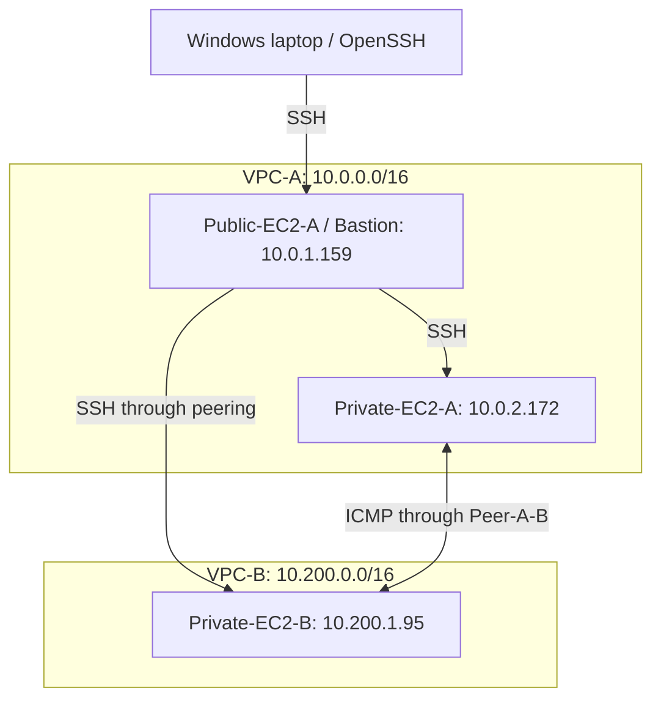
VPC-A has an internet gateway named IGW-A and a public subnet for the bastion. Both application instances use private subnets. VPC-B's resource map shows no internet gateway.
Network plan
VPCs
VPC	IPv4 CIDR	Region
VPC-A	10.0.0.0/16	ap-south-1
VPC-B	10.200.0.0/16	ap-south-1
Subnets
Subnet	VPC	IPv4 CIDR	Availability Zone	Route table
Public-SN-VPC-A	VPC-A	10.0.1.0/24	ap-south-1a	Public-RT-A
Private-SN-VPC-A	VPC-A	10.0.2.0/24	ap-south-1b	Private-RT-A
Private-SN-VPC-B	VPC-B	10.200.1.0/24	ap-south-1a	Private-RT-B
EC2 instances
All three instances are t3.micro instances and were Running in the captured screenshots.
Instance	Role	Private IPv4	Public IPv4
Public-EC2-A	Bastion / SSH jump host	10.0.1.159	Assigned; masked in screenshots
Private-EC2-A	Private workload in VPC-A	10.0.2.172	None
Private-EC2-B	Private workload in VPC-B	10.200.1.95	None
The SSH login screenshots show Amazon Linux 2023 on both private instances.
Route configuration
The peering connection is named Peer-A-B. All routes below show Active status in the screenshots.
Route table	Destination	Target
Public-RT-A	10.0.0.0/16	local
Public-RT-A	0.0.0.0/0	IGW-A
Public-RT-A	10.200.0.0/16	Peer-A-B
Private-RT-A	10.0.0.0/16	local
Private-RT-A	10.200.0.0/16	Peer-A-B
Private-RT-B	10.200.0.0/16	local
Private-RT-B	10.0.0.0/16	Peer-A-B
The routes to the remote VPC CIDR provide the path across the peering connection, including the return path.
Inbound security group rules
Security group	Traffic	Source
SG-Public-A	SSH / TCP 22	Administrator public IPv4 /32; masked in screenshots
SG-Private-A	SSH / TCP 22	10.0.1.159/32 — bastion
SG-Private-A	ICMP Echo Request	10.200.1.95/32 — Private-EC2-B
SG-Private-B	SSH / TCP 22	10.0.1.159/32 — bastion
SG-Private-B	ICMP Echo Request	10.0.2.172/32 — Private-EC2-A
SSH access
The local OpenSSH configuration defines three host aliases:
Alias	Destination	Jump host
project-bastion	Public-EC2-A	Direct SSH access
project-a	10.0.2.172	project-bastion
project-b	10.200.1.95	project-bastion
Both private host entries use ProxyJump project-bastion, with the remote user ec2-user and IdentitiesOnly yes.
From Windows PowerShell, the configured aliases are used as follows:
```powershell
ssh project-a
```
```powershell
ssh project-b
```
Connectivity validation
Run this command after logging in to Private-EC2-A:
```bash
ping -c 4 10.200.1.95
```
Run this command after logging in to Private-EC2-B:
```bash
ping -c 4 10.0.2.172
```
Captured results
Test	Source	Destination	Packets sent	Packets received	Packet loss
VPC-A to VPC-B	10.0.2.172	10.200.1.95	4	4	0%
VPC-B to VPC-A	10.200.1.95	10.0.2.172	4	4	0%
The captured tests demonstrate ICMP connectivity between the two private instances in both directions.
Implementation screenshots
1. VPC creation and resource maps
Two VPCs were created with non-overlapping CIDR ranges. The resource maps show their subnets, route tables, and network connections.
VPC overview
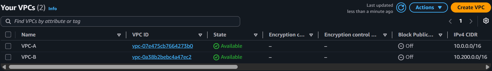
VPC-A resource map
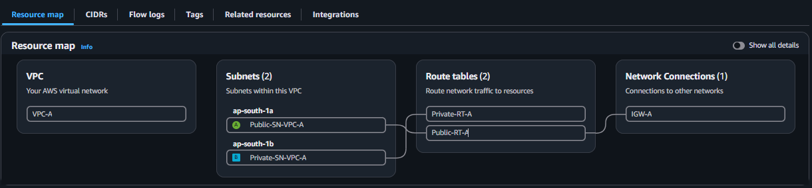
VPC-B resource map
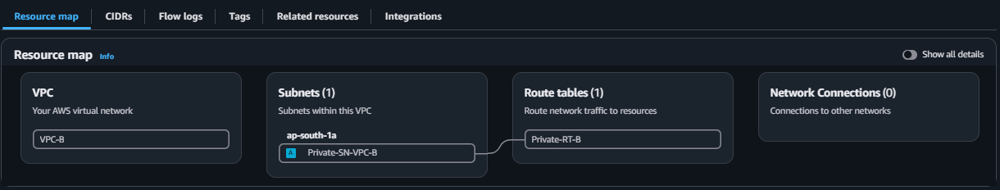
2. Subnet configuration
The subnet screenshots record CIDR ranges, VPC membership, Availability Zones, route table associations, and public IPv4 assignment settings.
Subnet overview
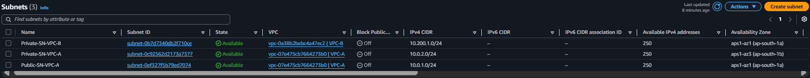
Private subnet in VPC-B

Private subnet in VPC-A

Public subnet in VPC-A
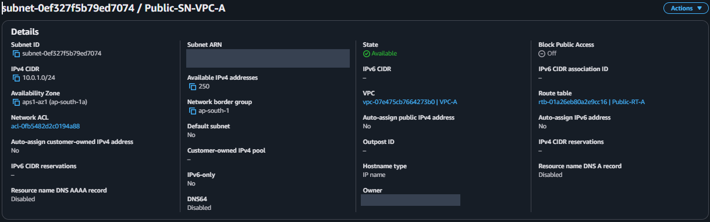
3. Route tables
The private route tables contain routes to the remote VPC through peering. The public route table also contains the internet gateway route and the route used to reach VPC-B.
Route table overview
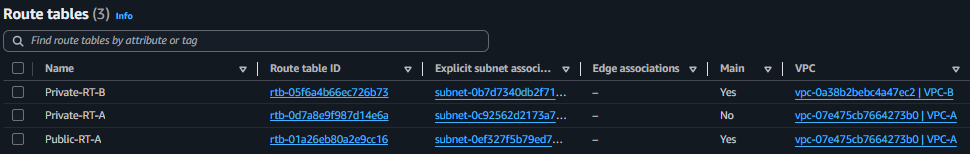
Private-RT-B
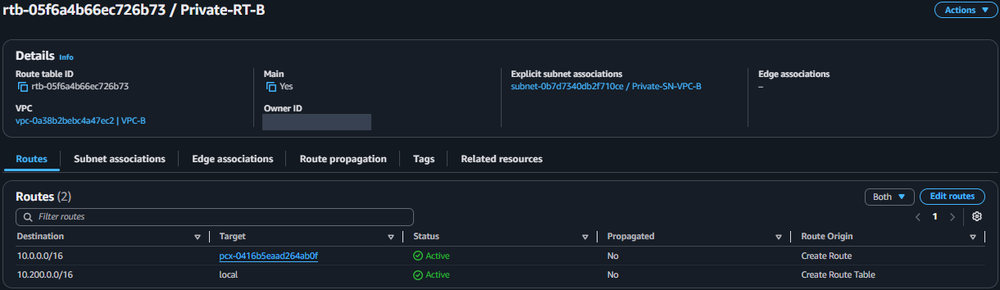
Private-RT-A
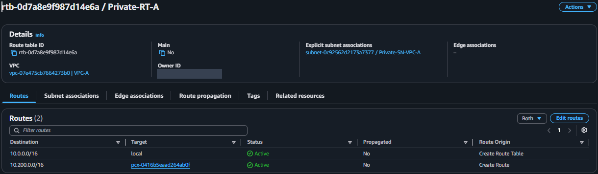
Public-RT-A
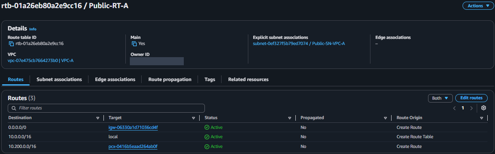
4. Internet gateway and peering connection
IGW-A is attached to VPC-A. Peer-A-B is Active and connects the two VPC CIDR ranges in the Mumbai region.
Internet gateway
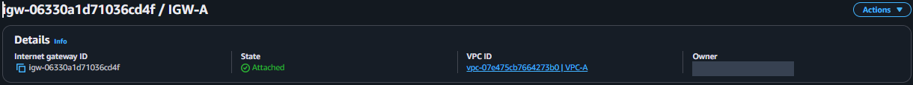
Active peering connection
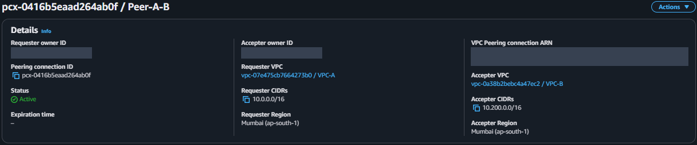
5. Security groups
The inbound rules restrict SSH to the administrator or bastion source and permit ICMP Echo Request traffic from the peer private instance.
Bastion security group
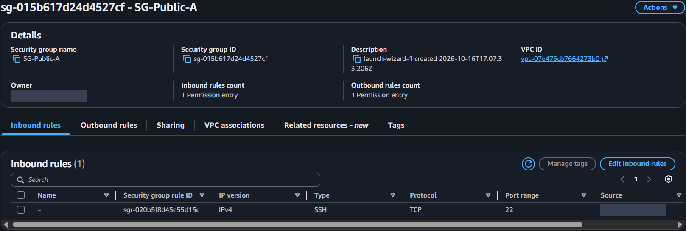
Private instance security group in VPC-A
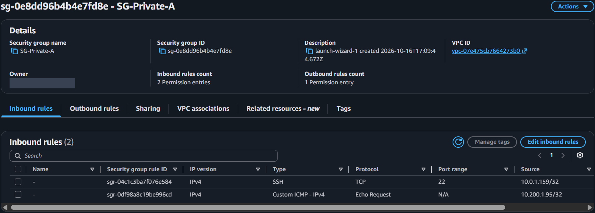
Private instance security group in VPC-B
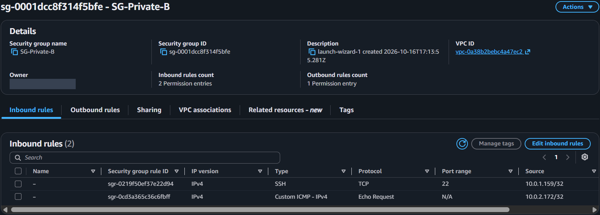
6. EC2 instance placement
The instance summaries show their private IP addresses, VPCs, subnets, and Running state. The two private instances have no public IPv4 addresses.
Public-EC2-A / bastion
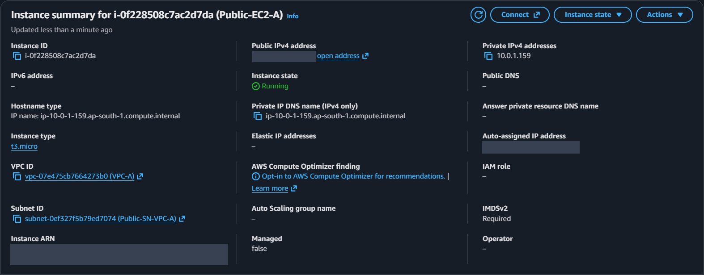
Private-EC2-A
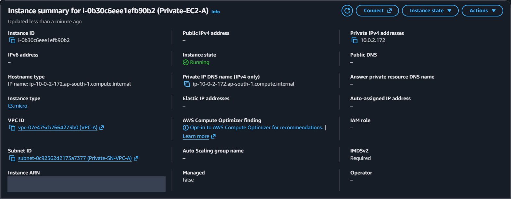
Private-EC2-B
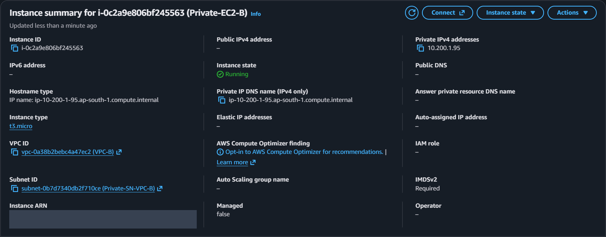
7. SSH access through the bastion
The login screenshots show successful sessions using the project-a and project-b aliases. The configuration screenshot records the ProxyJump settings for both private hosts.
SSH login to Private-EC2-A
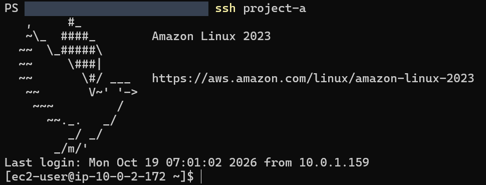
SSH login to Private-EC2-B
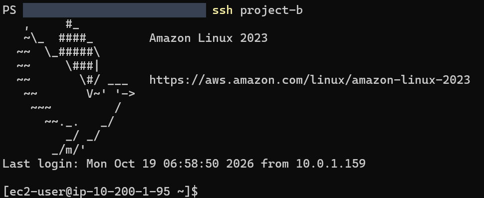
OpenSSH ProxyJump configuration
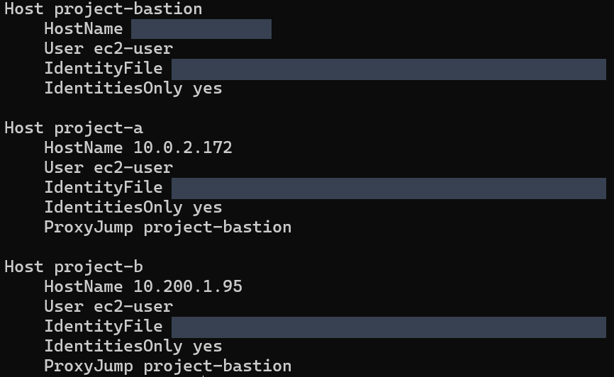
8. Bidirectional private connectivity
Both four-packet ping tests completed with four replies and 0% packet loss.
Private-EC2-A to Private-EC2-B
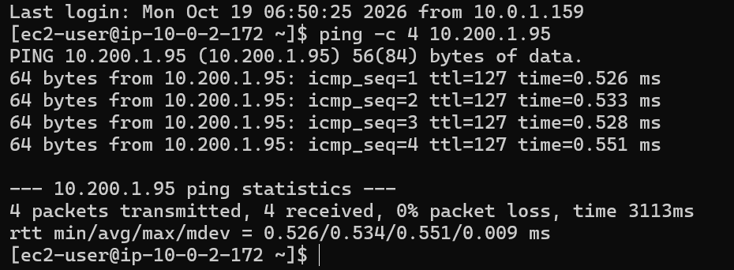
Private-EC2-B to Private-EC2-A
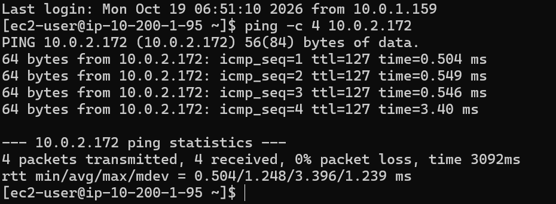
Skills demonstrated
IPv4 CIDR planning and VPC/subnet design.
Internet gateway attachment and route table configuration.
VPC peering with routes in both directions.
Source-restricted SSH and ICMP security group rules.
OpenSSH host aliases and ProxyJump access to private Linux instances.
Validation and documentation of private connectivity.
Screenshot redactions
AWS account identifiers, public IPv4 addresses, and local SSH key paths are masked in the screenshots.
